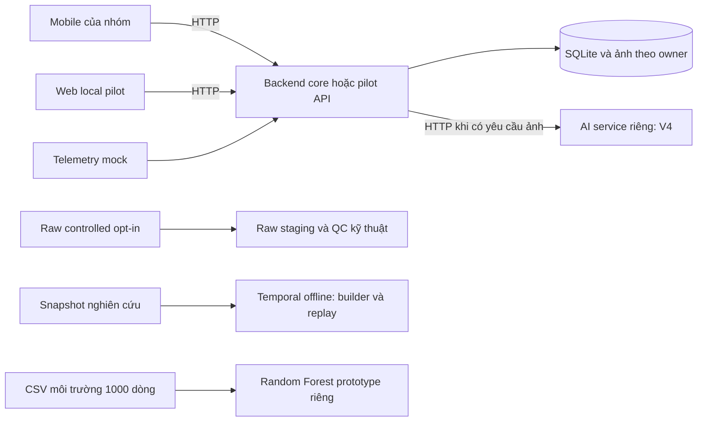

# AEGIS — Bản nháp chương báo cáo AI/ML và Backend cho midterm

Ngày tổng hợp: 03/11/2026, Asia/Bangkok. Task H6-T02, phạm vi AI/ML–Backend.
Hiện trạng đối chiếu đến mục89 của [file trạng thái](../AEGIS_PROJECT_STATUS.md).
Đây là bản nháp nội dung kỹ thuật để review, chưa phải báo cáo theo rubric của trường.
Không có lượt train/inference/demo/test suite mới trong lần biên soạn này.

## 1. Mục tiêu và phạm vi hệ thống

AEGIS hỗ trợ quản lý bối cảnh đồng ruộng, theo dõi điều kiện môi trường, nhắc kiểm
tra và lưu bằng chứng quan sát; nhận diện ảnh bổ sung thông tin về triệu chứng.
Đối tượng nghiên cứu cảnh báo ban đầu là đạo ôn lá. Mô hình ảnh nhận diện ba nhóm
nhãn nguồn: rice_blast, brown_spot và sheath_blight. Hai phạm vi không đồng nhất.

Luồng sản phẩm định hướng: chọn ruộng/mùa vụ → xem đánh giá điều kiện → mở công
việc theo dõi → quan sát/check → kiểm tra lại nếu bằng chứng đổi. Ảnh và lịch sử
là thông tin hỗ trợ trong bối cảnh mùa vụ. Phần môi trường hiện dùng mock/rule,
chưa được trình bày như mô hình dự báo bệnh đã huấn luyện.

Nguồn: [thiết kế MVP](../backend/docs/BLAST_WARNING_MVP.md),
[hồ sơ chức năng](THESIS_EVIDENCE.md), [contract mobile](../backend/docs/MOBILE_FOLLOWUP_API.md).

## 2. Kiến trúc và ranh giới triển khai

Sơ đồ thể hiện ranh giới module, không xác nhận mọi client đã tích hợp hoặc đang
chạy. Không có đường đưa output Random Forest vào Backend hoặc forecast trong
kiến trúc hiện hành đã đối chiếu.

- **Backend core:** Flask, tài khoản/session, ảnh/lịch sử, ruộng/mùa vụ/thiết bị,
  hồ sơ canh tác và đánh giá điều kiện mock. SQLite/uploads được cấu hình theo kho.
- **AI service riêng:** nạp YOLO/checkpoint; Backend gọi HTTP, kiểm response và lưu
  kết quả hợp lệ. Backend không import YOLO để xử lý inference tại chỗ.
- **Pilot opt-in:** mở rộng journal, intervention, follow-up, episode, assessment
  revision, survey/review/timeline và mock automation. Core mặc định không tự có pilot.
- **Web local:** source giao diện phục vụ trình diễn; launcher riêng mount UI.
  Entry point mobile pilot chỉ cung cấp API, không mount web assets hoặc tự bật worker.
- **Temporal offline:** chuẩn bị mẫu theo thời gian, snapshot/replay và kiểm leakage
  trên fixture; chưa có model forecast được train hoặc endpoint inference forecast.

Nguồn source: [Backend factory](../backend/app/__init__.py),
[AI HTTP client](../backend/app/ai_service.py), [AI service](../../AEGIS-AI/api/app.py),
[pilot factory](../backend/pilot_app.py), [launcher web local](../frontend/server.py),
[temporal README](../../AEGIS-AI/temporal_warning/README.md).

## 3. Chức năng đã triển khai và mức kiểm chứng

| Nhóm | Hành vi đã có | Trạng thái và giới hạn |
|---|---|---|
| Tài khoản | Register/login/me/logout, token expiry/revocation, owner isolation | Backend đã kiểm; native session/cache chưa nghiệm thu đầy đủ |
| Bối cảnh | Ruộng, mùa vụ, thiết bị mock, hồ sơ canh tác có revision | API đã có; metadata thật phải do nguồn cung cấp |
| Nhận diện ảnh | Upload, bounding box, nhãn, confidence, model hash/version, request ID | Có inference thực lịch sử; chưa chứng minh hiệu quả thực địa |
| Lưu trữ ảnh | History/detail/image theo owner | Backend đã kiểm, chưa xác nhận chính sách retention production |
| Môi trường mock | Assessment advisory/insufficient_data/no_pattern_detected, snapshot/history | Rule mô phỏng; field_validated=false, không xác suất bệnh |
| Follow-up | Open/acknowledged/checked/closed, ack/check/close/reopen, event bất biến, exact replay/version | Backend đã kiểm; trạng thái workflow không phải nhãn bệnh |
| Required/current và actions | Assessment-view, input constraints, eligibility ack/check, recheck | GET không giữ chỗ version hoặc validate observation client chưa gửi; POST quyết định cuối |
| Filter danh sách | Một state tùy chọn, lọc trước phân trang, default giữ hành vi cũ | H2-T01 hoàn thành; không filter task_kind/device/search |
| Journal/timeline | Observation/intervention revision, episode, timeline | Có trong pilot, không tự đồng nghĩa có trên mobile |
| Nghiên cứu | Survey/coverage/review, raw controlled opt-in, snapshot temporal | Công cụ phần mềm; không thay chuyên gia, consent, nhãn hoặc protocol frozen |
| Vận hành | Trace/quota/idempotency, backup/verify/restore, sentinel và runbook | Kiểm local tại các boundary đã chọn; không SLA hoặc security audit production |

Chi tiết API: [core](../backend/docs/API.md), [farm](../backend/docs/FARM_WARNING_API.md),
[follow-up](../backend/docs/MOBILE_FOLLOWUP_API.md),
[actions](../backend/docs/MOBILE_ACTIONS.md), [recovery](../backend/docs/MOBILE_RECOVERY.md).
Các dòng bổ sung sau28/10 lấy mốc mới ở mục86–89, không lấy ma trận cũ làm ngày hiện hành.

## 4. Phương pháp và kết quả AI ảnh

### 4.1. Model và cách sử dụng

V4 (YOLO11n, checkpoint baseline 50epoch) là model mặc định. Ảnh được xử lý
orientation EXIF; output bbox theo tọa độ pixel trên ảnh đã sửa orientation.
Contract hiện dùng imgsz640 và confidence threshold0,25. V4, class mapping,
threshold và split không bị thay đổi trong H6-T02. Boundary-r2 và FT25 giữ vai trò candidate.

Không có detection chỉ có nghĩa model không trả detection vượt điều kiện hiện
tại, không xác nhận cây khỏe. Confidence không phải xác suất bệnh đã hiệu chuẩn.
Nguồn: [API ảnh](../backend/docs/API.md) và [AI service](../../AEGIS-AI/api/app.py).

### 4.2. Thí nghiệm FT25 ngày30/10/2026

FT25 khởi tạo từ trọng số V4 rồi train thêm25epoch mới, optimizer/scheduler reset;
không gọi đây là resume liên tục epoch51–75. V4 và candidate được so sánh trên
cùng1034ảnh/3161GT validation của nguồn, FP32,imgsz640,batch4,conf0.001,IoU0.7,max_det300.
Ngưỡng validator này khác ngưỡng hiển thị/API0,25; không trộn các loại metric.

| Chỉ số validation | V4 | FT25 | Chênh lệch điểm phần trăm |
|---|---:|---:|---:|
| mAP50 | 68,79% | 69,31% | +0,52 |
| mAP50–95 | 32,58% | 33,33% | +0,75 |
| AP50 riêng rice_blast | 68,36% | 67,44% | −0,92 |

Candidate tăng chỉ số tổng nhưng giảm AP50 lớp đạo ôn, nên không kết luận tốt hơn
mọi lớp và không tự đổi mặc định. Chỉ một seed cho FT25; chưa đánh giá test/field
trong thí nghiệm này. Validation đã được xem nhiều lần, không phải holdout thực địa.

Nguồn số liệu: [comparison.json](../../AEGIS-AI/experiments/v4_finetune25_20261030/comparison.json),
[báo cáo phương pháp/kết thúc FT25](../../AEGIS-AI/experiments/v4_finetune25_20261030/REPORT_VI.md).
Metric được đọc/tính đối chiếu khi viết báo cáo; không chạy validator mới.

## 5. Dữ liệu môi trường và prototype IoT

H3-T01 đã tiếp nhận CSV1000dòng gồm temperature,humidity,rainfall,soil_ph,disease
và Word đi kèm. Intake không phát hiện missing/nonfinite/duplicate/conflicting
feature-label theo kiểm tra đã ghi; điều này không chứng minh nguồn/nhãn đúng.
CSV thiếu timestamp, định danh thiết bị/ruộng/mùa vụ và metadata thu/gán nhãn.
Nguồn/quyền chưa xác minh đầy đủ, H4-T01 vẫn một phần và đang tạm gác theo người dùng.

Ngày02/11 có lượt train RandomForest theo yêu cầu riêng:200trees,max_depth8,
min_samples_leaf2,seed42;800dòngtrain/200dòngđánh giá theo membership cũ.
Đặc trưng là4cột môi trường; đầu ra4nhãn được cung cấp, gồm Healthy.

| Chỉ số khớp nhãn CSV trên200dòng đánh giá đã dùng trước | Kết quả |
|---|---:|
| Accuracy so với nhãn được cung cấp | 99,50% (199/200) |
| Macro-F1 | 0,994050 |

Đây là phân loại tĩnh, chưa deploy; không dự báo thời gian tương lai, không
xác nhận chất lượng cảm biến hoặc bệnh thật. Nhãn Healthy của CSV không được
gộp với no_detection của YOLO. Không dùng99,5% làm hiệu quả chẩn đoán ngoài ruộng.

Nguồn: [intake](../h3_t01_intake_20261102/REPORT_VI.md),
[nguồn/quyền](../h4_t01_source_20261102/REPORT_VI.md),
[protocol RF](../iot_prototype_rerun_20261102/protocol.json),
[metrics RF](../iot_prototype_rerun_20261102/results/metrics.json),
[deployment status](../iot_prototype_rerun_20261102/status.json).

## 6. Temporal và giới hạn khoa học

Đã có builder/lookback120h, quản lý availability/as-of, snapshot/revision,
group-time split có purge và audit một số đường leakage bằng synthetic.
Mục tiêu horizon72h/lịch24h vẫn là đề xuất nghiên cứu, chưa phải lead time đã đạt.
Rule, YOLO, peer tự khai hoặc mock không thay ground truth bệnh độc lập.
Chưa có model forecast đã train, metric event/false-alert/lead time thực địa
hoặc endpoint trả risk của mô hình temporal.

Các cổng còn thiếu: nguồn/quyền và vai trò → endpoint/SOP được chuyên môn xem
xét → dữ liệu/QC/cluster và split/holdout phù hợp → readiness → train được cho
phép riêng → đánh giá theo protocol. Không tự freeze protocol trong báo cáo.
Nguồn: [temporal README](../../AEGIS-AI/temporal_warning/README.md),
[protocol DRAFT](../../AEGIS-AI/temporal_warning/RESEARCH_PROTOCOL_v0.2_DRAFT.md).

## 7. Bằng chứng kiểm thử phần mềm và bàn giao

| Ngày / phiên | Kết quả lịch sử được phép trích | Giới hạn |
|---|---|---|
| 29/10 — H1-T01 | 300tests CPU trong env cài mới, cùng máy Windows | Không máy thứhai/GPU/field; không phải lượt vừa chạy ở H6-T02 |
| 29/10 — H5-T01 | 9tests session mới +20liên quan đạt | Không native token/cache hoặc security audit |
| 02/11 — H5-T03 | 2focused+2regression; crash boundary restore, fresh destination recovery | Không mất điện/hỏng đĩa thật; không RPO/RTO production |
| 02/11 — H2-T02 | 8focused (gồm1HTTP) +15regression đạt | Không strict parser/native; projection chưa validate lựa chọn observation |
| 02/11 — H2-T04 actions | 35HTTP/191assertions từ source gói,2task_kind | Store synthetic dọn sau chạy; không IDs/account live |
| 03/11 — H2-T01 | 6focused (gồm1HTTP) +11regression đạt;18tempdir sạch | Không fullsuite/native/freshinstall |
| 03/11 — H2-T04 state package | Source152file,manifest177file;ZIP/extract/verify đạt | Lượt đóng gói không chạy runtime mới; nhóm chưa nhận scope |

Không cộng các phiên thành số test độc lập hoặc dùng test pass rate làm accuracy bệnh.
Nguồn: [H1 acceptance](../h1_t01_fresh_cpu_20261029/ACCEPTANCE.json),
[session acceptance](../h5_t01_sessions_20261029/ACCEPTANCE.json),
[restore acceptance](../h5_t03_restore_20261102/ACCEPTANCE.json),
[actions acceptance](../h2_t02_actions_20261102/ACCEPTANCE.json),
[fixture summary02/11](../h2_t04_actions_handoff_20261102/packaged_fixture01/summary.json),
[filter acceptance03/11](../h2_t01_state_filter_20261103/ACCEPTANCE.json),
[package acceptance03/11](../h2_t04_state_handoff_20261103/ACCEPTANCE.json).

## 8. Phạm vi đóng góp và phối hợp

Người dùng xác định phạm vi AI/ML–Backend từ đầu và ở H6-T02 phát biểu:
“Tôi sẽ phụ trách làm toàn bộ công việc”. Báo cáo ghi nhận đây là trách nhiệm
công việc tiếp theo, chưa dùng làm bằng chứng tác giả mọi module/thí nghiệm cũ.
Bảng đóng góp chi tiết ở [CONTRIBUTIONS_AI_BACKEND_DRAFT.md](CONTRIBUTIONS_AI_BACKEND_DRAFT.md).

Mobile từng được xác định do thành viên khác phụ trách; chưa có xác nhận nhận
scope follow-up. H6-T02 không tự chuyển sang viết mobile hoặc xác nhận tích hợp.
Nếu phân công toàn dự án thay đổi, cần ghi module/phần bàn giao thực tế vào bảng
đóng góp; không sửa lịch sử kết quả thành công lao đã xác minh.

## 9. Kế hoạch tiếp theo cho midterm

| Công việc | Đầu ra nhỏ và điều kiện bắt đầu | Vai trò trong kế hoạch |
|---|---|---|
| H6-T01 | Mapping rubric chính thức với bằng chứng khi người dùng cung cấp | Xác định nội dung bắt buộc, không tự đặt tiêu chí trường |
| H2-T04 | Nhóm nhận scope; nghiệm thu list/filter/actions/check/recheck trên client | Hoàn thiện trải nghiệm xuyên suốt; không thêm API khi chưa có lỗi/gap |
| H3-T01/T02 | Nhận mẫu logger có metadata rồi adapter một format với lineage/retry | Mở đường dữ liệu thực; CSV hiện tại chưa thay mẫu logger |
| H3-T03 | QC theo units/clock/cadence đã được chốt | Nhận biết missing/duplicate/sai thời gian; không dựng số đo thay thế |
| H4 | Tiếp tục chỉ khi có nguồn/quyền/chuyên môn và readiness phù hợp | Chưa train forecast hoặc tự mở lại H4-T01 đang tạm gác |

Chưa mở task triển khai nào từ bảng này. Demo rehearsal chỉ chọn ở H6-T04 khi có
ngày, môi trường và kịch bản cần kiểm; không chạy lại chỉ để tăng bằng chứng.

## 10. Đoạn phát biểu ngắn có thể dùng ở midterm

> AEGIS đã xây dựng Backend quản lý bối cảnh đồng ruộng, lịch sử và dịch vụ AI
> nhận diện ba nhóm bệnh từ ảnh. Pilot đã có đánh giá điều kiện môi trường mô
> phỏng và quy trình follow-up với truy vết, version, retry và recheck. Phần
> mobile đang chờ nghiệm thu tích hợp. Prototype phân loại CSV môi trường đã
> train nhưng nguồn và nhãn chưa xác minh, chưa phải forecast. Giai đoạn tiếp
> theo tập trung hoàn thiện tích hợp và dữ liệu đủ điều kiện để đánh giá thực tế.

Không nói “hệ thống chính xác99,5% ngoài ruộng”, “forecast72h đã hoàn thành”,
“no_detection là khỏe”, “gói đã có nghĩa mobile đã tích hợp” hoặc một tỷ lệ hoàn
thành toàn đồ án khi chưa có rubric/phạm vi nhóm được xác nhận.

Danh mục hash/nguồn được kiểm trong lần biên soạn:
[EVIDENCE_REGISTRY.json](../h6_t02_midterm_20261103/EVIDENCE_REGISTRY.json).
